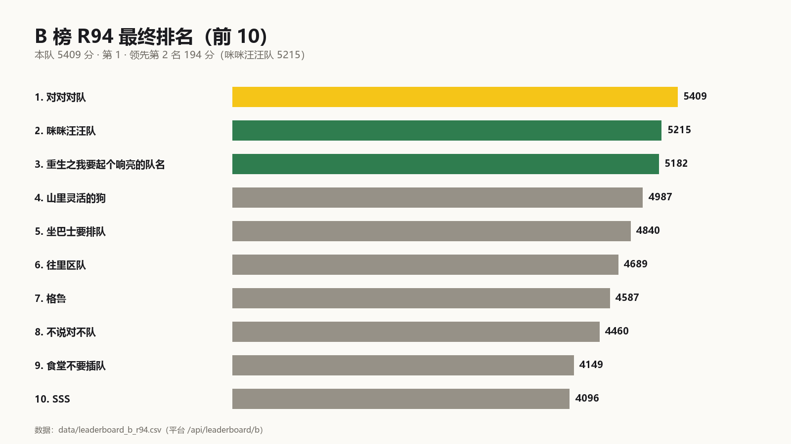
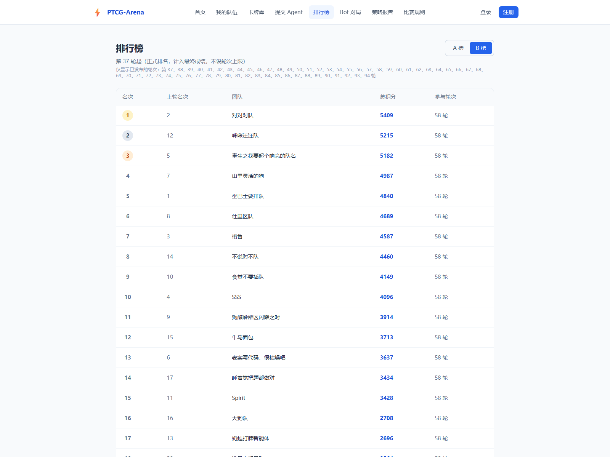
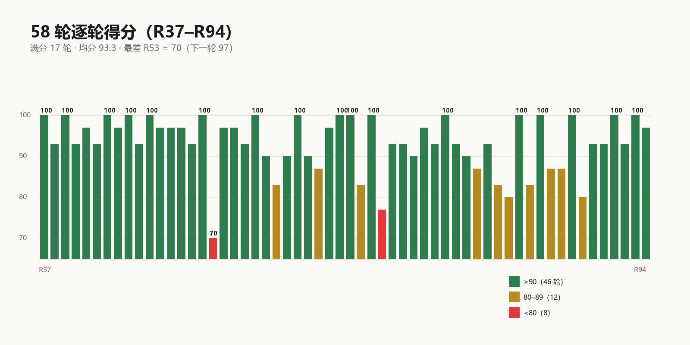
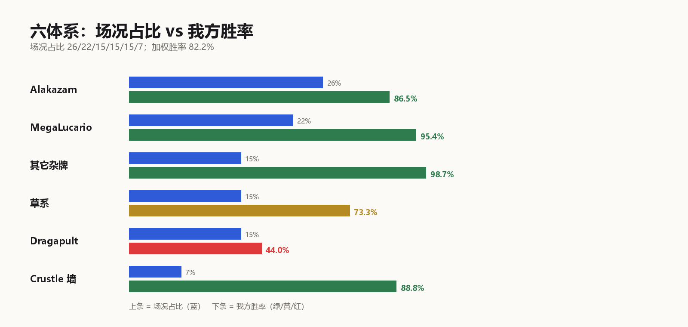
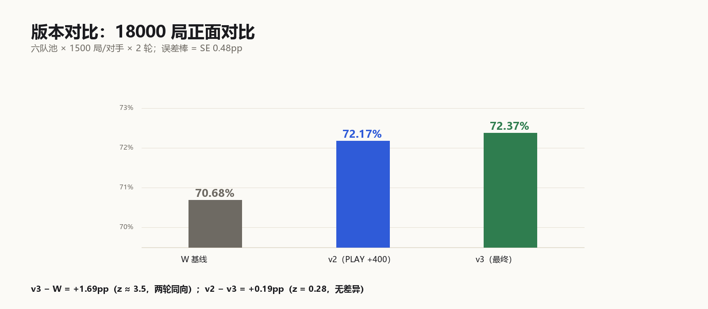

# PTCG-Arena 策略报告

> 队伍：对对对队　｜　赛道：曲阜师范大学 PTCG-Arena　｜　版本：v3（提交 id 622）
> 提交格式：Markdown　｜　数据截至：B 榜 R94（提交时最新已结算轮）

---

## 0. 60 秒导读（不懂宝可梦也能读）

**这是什么游戏。** 双方各带 60 张牌，场上最多 1 只出战宝可梦 + 5 只备战。每回合可以出牌、贴能量、进化、使用特性/支援者、攻击。先拿完 6 张奖赏卡（Prize）的一方获胜；场上没有宝可梦或牌库抽空也会输。`ex` 是强力宝可梦，被击倒时对方拿 2 张奖赏（Mega ex 3 张），所以「用非 ex 打 ex」在奖赏交换上天然吃亏，但也因此免疫「只针对 ex」的卡。

**我们做了什么。** 用 Hop's Trevenant（非 ex，140HP）做主攻，靠 Postwick / Hop's Choice Band / Hop's Snorlax 把 90 伤害的 Corner 堆到 180（被击倒后的 Horrifying Revenge 可到 220），再用 Mist Energy 挡效果伤害。60 张里没有一张是边角料：抽掉任意一块，对应体系胜率掉 2–6pp。

**结果。** B 榜 58 轮 5409 分第 1；1566 局 82.2%。六体系里四个 ≥86%，草系 73.3%，Dragapult 44.0% 是唯一明显低于 70% 的对位。

**一句话。** 我们不是「最强牌组」，而是「在当前场况结构里最不容易输的牌组」；报告的后半部分用 20 次改动证明：再改也改不动了。

**术语**：`pp` = 百分点；`z` = 两比例差的标准化统计量（|z| ≥ 2 约等于 95% 置信）；`ACE SPEC` = 全牌组只能带 1 张的特殊卡；`奖赏` = Prize card。

---

## 图表索引

| 图 | 内容 | 位置 |
|---|---|---|
| 图 1 | 58 轮逐轮得分（满分/掉分分布） | 摘要之后 |
| 图 2 | 六体系场况占比 vs 我方胜率 | §4.1 之后 |
| 图 3 | 三个版本 18000 局对比 | §6.4 之后 |
| 图 4 | B 榜 R94 前 10 名（第 1） | 摘要内 |

---

## 摘要

本文报告我们在 PTCG-Arena 中的完整策略：**如何在一个由卡面数值与规则文本主导的引擎里，用一个非主流的非 ex 攻击手体系拿到 B 榜第一，并且用可复现的证据证明「当前版本已经到顶」。**

最终成绩：B 榜 58 轮 **5409 分（第 1，领先 194 分）**，战绩 1286-277-3，胜率 **82.2%**；
A 榜 34 轮 3008 分（第 2）。



> **图 4**｜B 榜 R94 最终排名前 10：本队 5409 分居首，领先第 2 名（咪咪汪汪队 5215）194 分。
> 数据：`data/leaderboard_b_r94.csv`。



> **图 5**｜平台「排行榜 / B 榜」页面原始截图（2026-10-28 抓取）：第 1 名 对对对队 5409 分 / 58 轮，
> 第 2 名 咪咪汪汪队 5215 分。页面注记「第 37 轮起（正式排名）」。
> 抓取方式：Edge headless 打开 `http://115.159.47.81/leaderboard`（公开接口渲染，无需登录）。

三个与直觉相反的核心结论：

1. **名次不是强度排序，而是规则闭环**：B 榜前五里，Alakazam（第 2）、草系（第 3）、Crustle（第 4）三支我们对位 73–89%；唯一克制我们的 Dragapult 队伍（第 5）对我们 44%。
2. **我们唯一的死角（Dragapult，44.0%）不是实现问题，是卡池层面的规则问题**：对方 200 伤害一击必杀我们 140HP 的攻击手，而我们打它要两拳。
3. **在这个赛制里，「证明没有更强版本」比「再多赢一轮」更有价值**：我们做了 20 次改动实验，其中 13 项给出可判定的否定结论，并记录了 3 次被复测抓回的假阳性。

---



> **图 1**｜58 轮逐轮得分（R37–R94）。绿色 ≥90（46 轮）、黄色 80–89（12 轮）、红色 <80（8 轮）；
> 满分 17 轮，最差 R53 = 70（下一轮 97）。数据：`data/rounds.json`。

## 1. 赛制、目标与约束

### 1.1 赛制

- 每轮为**单循环赛**，任意两队对战 1 局。B 榜 28 队 → 每队每轮 **27 局**；我们 58 轮（R37–R94）共 **1566 局**（1286 胜 277 负 3 平）。
- 积分按**本轮名次**赋分：第 1 名 100 分，最后一名 10 分，中间按参赛队数线性递减；B 榜总积分 = 各轮积分之和（详见 `docs/RULES_AND_SCORING.md`）。
- 提交内容 = **一份 60 张的牌组** + **一个 agent 程序**（自动对战）。
- 提交后整轮生效，**中途换提交会污染该轮数据**（我们踩过这个坑，见 §7.4）。
- 策略报告评审权重：**稳定性 30% + 独创性 30% + B 榜排名 40%**；B 榜结束后 24 小时内提交。

### 1.2 我们的目标函数

不是「赢最多」，而是三段式的：

| 阶段 | 目标 | 判断标准 |
|---|---|---|
| 探索期 | 搞清引擎的动作语义 | 主力招式能稳定打出 |
| 巩固期 | 找到能吃到多数场况的牌组 | 加权胜率 > 80% |
| 收尾期 | 证明当前版本不可再改进 | 每个候选都能给出否定证据 |

### 1.3 硬约束

- 没有官方 API 文档，动作语义靠逆向；
- 只能在提交后的整轮看到结果，单局不可控；
- 本地陪练池保真度有限（§6.3），是全部实验设计的前提。

---

## 2. 牌组策略：为什么选一个「非 ex 攻击手」体系

### 2.1 最终牌组（60 张，submission 622）

| 类别 | 卡 | 张数 | 角色 |
|---|---|---:|---|
| 攻击手 | Hop's Trevenant | 4 | 主攻，**非 ex**，140HP |
| 进化底 | Hop's Phantump | 4 | 稳定进化线 |
| 副攻 | Hop's Cramorant | 4 | 先手压制，120 伤害 / 110HP |
| 肉盾 | Hop's Snorlax | 2 | 备战区 +30 伤害，150HP |
| 能量 | Mist Energy | 4 | 防效果伤害（承重，见 §5.2） |
| 能量 | Telepath Psychic Energy | 4 | 主能量 |
| 竞技场 | Postwick | 4 | **Hop's 招式 +30 伤害**（承重） |
| 道具 | Hop's Choice Band | 4 | **Hop's 招式 +30 伤害**（不是 ×1.3） |
| 检索 | Hop's Bag / Poké Pad / Pokégear 3.0 | 4 / 4 / 2 | 稳定 T3 成型 |
| 检索 | Buddy-Buddy Poffin | 2 | 铺 70HP 以下基础宝可梦 |
| 回收 | Night Stretcher | 2 | 复活攻击手 |
| 切换 | Switch | 2 | 换出战位 |
| ACE | Treasure Tracker | 1 | 额外检索（限 1 张） |
| 支援者 | Lillie's Determination / Hilda | 4 / 4 | 补牌与检索进化 |
| 支援者 | Boss's Orders / Xerosic's Machinations / Lana's Aid | 2 / 2 / 1 | 定点击杀 / 削手 / 回收 |

合计 **60 张**。逐张说明见 [`submission/deck.md`](./submission/deck.md)，原始提交见 [`submission/deck.csv`](./submission/deck.csv)。

### 2.2 为什么是「非 ex」

这是整套策略的根：**ex 宝可梦会被针对 ex 的卡面效果直接克制，而对手的克制卡在场上非常常见。**

典型例子（§4.1 会详细展开）：Crustle（150HP）的 `Mysterious Rock Inn` 让「对手 ex 宝可梦对它自身的攻击伤害全部无效」。
我们如果把攻击手换成 ex，就等于把「墙队 88.8% 的胜率」直接交出去。

代价是：非 ex 攻击手的血量上限低（140HP），因此会被 200 伤害的招式一击必杀 —— 这构成了我们唯一的死角。

### 2.3 伤害模型

```
Corner（稳定主招）      = 90 基础 + 30 Postwick + 30 Choice Band + 30 Snorlax = 180
Horrifying Revenge     = 30 基础（若上回合有 Hop's 宝可梦被击倒则 +100 = 130）
                         130 + 30 Postwick + 30 Choice Band + 30 Snorlax = 220（条件值）
```

180 / 220 意味着：
- 打 150HP 的 Crustle：**满 buff 一拳**（180 ≥ 150）；没有 Snorlax 时 150 也刚好够；完全无 buff 时 2 拳。
- 打 320HP 的 Dragapult ex：**2 拳**（180×2 = 360 > 320）。
- 但对方 200 伤害打我们 140HP：**1 拳**。

**同样的「击杀一次」，我们付两拳的代价，对方付一拳。** 这一条决定了 §5.1 的奖赏效率差。

> 修订说明：初版把「Corner 90」误写成「130 基础」，又把 Crustle 的 150HP 误写成 110HP；本版按 `data/cards.csv` 的卡面数值重算。

### 2.4 牌组的六块承重结构

这副 60 张里没有一张是「可替换的边角料」。抽掉任意一块，对应体系的胜率会掉 2–6pp：

| 结构 | 抽掉/换掉的后果 | 统计量 |
|---|---|---:|
| Mist Energy ×4 | Alakazam −5.53pp | z = −3.17 |
| Snorlax 两条硬规则 | Dragapult −5.84pp | z = −4.13 |
| ACE 位 Treasure Tracker | Dragapult −5.60pp | z = −3.54 |
| 搜索引擎 | Dragapult −4~−9pp | 多轮复测 |
| 能量 8 张 | −2.37 / −2.27pp | 两轮复测 |
| 支援者位 | −4.3 ~ −6.4pp | 多轮复测 |

「换个牌组」的实际效果 = **换掉整条链**，场况加权实测 −3.95pp。

---

## 3. Agent 策略：动作语义的逆向与决策逻辑

### 3.1 逆推出的动作协议

引擎 `cabt`（kaggle-environments 提供）没有公开文档，我们通过对照「同一状态下不同动作的结果」逆推出动作表：

| 值 | 动作 | 值 | 动作 |
|---:|---|---:|---|
| 7 | PLAY（从手牌出牌） | 12 | RETREAT（撤退） |
| 8 | ATTACH（贴能量） | 13 | ATTACK（攻击） |
| 9 | EVOLVE（进化） | 14 | END（结束回合） |
| 10 | ABILITY（使用特性） | 6 | 招式选择（`select.type = 6`） |

### 3.2 第一个致命 bug：把「选招式」当成「选卡」

`select.type = 6` 的选项列表长得很像手牌列表，早期 pilot 因此把它当「选一张卡」处理，
结果是**主力招式一次都没打出来**，胜率长期停留在个位数。

v2 的修复：把 `select.type = 6` 的收益设为 **PLAY +400**（即「选招式」这个动作被认为价值极高），
让 agent 优先选择它。这一改动的效果见 §6.4（v2 从 70.68% → 72.17%）。

### 3.3 v3：合法性守卫

v2 在长对局里仍有约 3% 的局面会输出非法动作（越界下标、未满足 minCount 的数量承诺），
一局非法即判负。v3 加了两个守卫：

1. **越界下标过滤**：候选下标必须落在合法区间内；
2. **minCount 补齐**：当引擎要求「必须选 N 个」时，把不足的候选按价值降序补齐。

v3 vs v2：72.17% → **72.37%**（+0.19pp，z = 0.28，**没有显著差异**）；v3 vs 基线 W：**+1.69pp**（z ≈ 3.5，两轮同向）。
因此 v3 的取舍不是「守卫带来 3.5σ 提升」，而是「在 v2/v3 无差异时，选方差更小、非法动作更少的 v3」。

### 3.4 决策打分（简化）

```
价值(动作) = 伤害收益 × w1
           + 奖赏进度 × w2
           + 场面存活 × w3
           + 检索/铺场 × w4
           + 招式选择加成（select.type=6 → 400）
```

其中「伤害收益」并非线性：击杀对方 ex（通常 2 奖赏，Mega ex 3 奖赏）的权重远高于普通击杀。

### 3.5 为什么不再做「更强的 agent」

后期我们做过 6 组 agent 层实验（换人阈值、后备预充能、定向拉人、硬规则拉人、Mist 贴备战、Hand Trimmer 时机版），
**全部为负或无效应**（详见 §7.1）。结论：这套牌组的收益边界由牌组结构决定，agent 层已到平台期。

---

## 4. 对手环境：38 队逆向与场况结构

### 4.1 场况构成（B 榜 1566 局，逐局归档）

| 体系 | 场况占比 | 局数 | 我方胜率 | 胜负场 |
|---|---:|---:|---:|---:|
| Alakazam 系 | 26% | 406 | 86.5% | 351-55 |
| MegaLucario | 22% | 348 | 95.4% | 332-16 |
| 其它杂牌 | 15% | 232 | 98.7% | 229-3 |
| 草系（Ogerpon） | 15% | 232 | 73.3% | 170-62 |
| **Dragapult** | 15% | 232 | **44.0%** | **102-130** |
| Crustle 墙 | 7% | 116 | 88.8% | 103-13 |

加权胜率 = 0.26×86.5 + 0.22×95.4 + 0.15×98.7 + 0.15×73.3 + 0.15×44.0 + 0.07×88.8 = **82.2%**

关键观察：**70% 的场况被我们吃到 86–99%，全部失分集中在 15% 的 Dragapult 上。**
这意味着名次完全取决于「能不能吃到多数场况」，而不是「能不能打过最强的体系」。



> **图 2**｜六体系：蓝条为场况占比（26/22/15/15/15/7），下条为我方胜率（绿≥85、黄 70–85、红<70）。
> 加权 82.2%；唯一红色是 Dragapult 44.0%。数据：`data/final_arche.json`。

### 4.2 规则闭环：名次是结构给的

| 对位 | 结果 | 规则依据 |
|---|---|---|
| 我们 → Crustle 墙 | 103-13（88.8%） | 我们是非 ex 攻击手，打得动 150HP 的墙 |
| 墙 → Dragapult | 墙胜 | `Mysterious Rock Inn`：对手 ex 对它的攻击伤害全部无效 |
| Dragapult → 我们 | 102-130（44.0%） | `Phantom Dive 200` 一击秒掉我们 140HP |

B 榜前五名中，Alakazam（第 2）、草系（第 3）、Crustle（第 4）三支我们对位 73–89%；
唯一明显克制我们的 Dragapult 队伍（坐巴士，第 5）排在第 5。**这个闭环在「非 ex」约束下没有出口**：
要赢它需要「一拳 320」或「活过 200」——
- 换成 ex 确实能一拳 320（Zacian ex 330 > 320），但会把 Crustle 对位交出去（实测 −23.25pp，§7.1 #16）；
- 单张 Hero's Cape 能让一只攻击手活过 200，但 ACE SPEC 限 1，且本地池保真不足（§5.4），场况上没验证出收益。

所以「无解」更准确的表述是：**在不牺牲 70% 场况的前提下无解**，而不是卡池里绝对没有这些数值。

### 4.3 逆向方法：只用公开规则还原 38 队牌组

我们只用了三条官方规则作为约束：

1. 开局抽牌归一化（起手必然出现的卡）；
2. 同名卡 ≤ 4 张，ACE SPEC ≤ 1 张；
3. 至少 1 张基础宝可梦。

方法：每队每时代采集 ≥10 局（约 70 张起手样本）→ 统计每张卡的出现频次与回合 → 反推数量；
同名卡靠**招式名**反查（不同卡池的同名卡招式不同）。

效果：**约 24 局日志 / 70 张起手样本可还原 58/60 张，单队约 10 秒**；B 榜 28 队与 A 榜 38 队（去重后 38 支）全部完成，其中 6 支队伍在赛季中途换过阵。
行为节奏（每队 6 局抽样）：Dragapult 4.00 攻击/19.3 出牌、Alakazam 4.67/12.2、
MegaLucario 4.00/15.3、Crustle 3.50/8.0。

### 4.4 换阵台账（6 支）

| 队伍 | 换阵内容 | 影响 |
|---|---|---|
| 老实写代码 | 毒系 → Dragapult（R67） | 与我们对位 56% → 44% 的下滑时间点完全吻合 |
| 谁是大明星 | MegaLucario → Alakazam | 我方胜率上升 |
| 山里灵活的狗 | Crustle → Crustle + Budew | 墙队更难打 |
| 狗熊岭 | MegaLucario → Hop's | 同系内战，胜率基本不变 |
| 食堂 | 加 Battle Cage ×3 + Xerosic | 我方道具被压 |
| 大狗队 | 加 Battle Cage + Enriching | 同上 |

**Dragapult 家族从 2 支扩到 4 支**，是我们后段掉分的主要外部原因。

> 口径说明：本表的「6 支」是**人工逐队核对**卡表得到的换阵（含 Battle Cage / Xerosic / Budew 这类道具级针对）；若改用「前后两段卡名集合 Jaccard < 0.70」的机器口径，则识别出 3 支结构性换阵 + 4 支同体系大幅卡位调整，合计 7 支。两种口径的差异与原始数据见 [`docs/RECON_38_TEAMS.md`](./docs/RECON_38_TEAMS.md) 与 `data/opponents_decks.csv`。

---

### 4.5 实验 × 对位矩阵

矩阵的行是**我们试过的牌组变体**，列是六个对手体系；格子里的数字是该变体相对 v3 的**胜率变化（pp）**，
"—" 表示该格没测（不臆造）。数据：`data/matchup_matrix.csv`。

| 变体 | Alakazam | MegaLucario | 其它 | 草系 | **Dragapult** | 墙 | 结论 |
|---|---:|---:|---:|---:|---:|---:|---|
| **v3（最终）** | 86.5% | 95.4% | 98.7% | 73.3% | **44.0%** | 88.8% | 采用 |
| ht2_mist 削手 | — | — | — | — | −4.87 | — | 否定 |
| ht2_true 削手 | −5.53 | — | — | — | — | — | 否定 |
| ht4（4×Trimmer） | — | — | — | — | −6.47 | — | 否定 |
| ht2_xer4 | — | — | — | — | −7.35 | — | 否定 |
| snorlax3 | +3.00→+0.03 | — | — | — | +0.33→+0.44 | — | 假阳性，回滚 |
| nz1（换 ACE） | −3.25 | — | — | — | −2.05 | — | 否定 |
| stretch3（换 ACE） | — | — | — | — | −5.60 | — | 否定 |
| zacian3 换血 | −23.25 | — | — | — | +0.83 | — | 否定 |
| boss4（拉人×4） | — | — | — | — | — | — | 加权 −4.29，否定 |
| cape1（换 ACE） | — | — | — | — | −0.34 | — | 无差异 |
| 能量 8→10 | — | — | — | — | −2.37 | — | −2.27（加权），否定 |
| 砍 Mist ×2 | −5.53 | — | — | — | — | — | **承重实证** |
| 消融 Snorlax 规则 | — | — | — | — | −5.84 | — | **承重实证** |

**为什么不是严格的 6×6**：我们全程只有**一套参赛牌组**（v3），所以"我们 6 套 × 对手 6 体系"的完整矩阵
不存在；能构成矩阵的是"**15 个变体 × 6 个对手体系**"，且多数变体只被有针对性地在 1–2 个体系上复测
（因为本地池分辨率只有 3–4pp，全面铺开既慢又测不准）。
把没测的格子留成 "—"，比填一个靠插值猜出来的数字更可靠。

## 5. 关键发现

### 5.1 奖赏效率差一倍，且击杀反而给对方资源

**效率结构**：

| | 对方 | 我方 |
|---|---|---|
| 单次击杀所需 | 1 拳 | 2 拳 |
| 换得奖赏 | 1 | 2 |
| **每次击杀效率** | **1.0 奖赏/拳** | **0.5 奖赏/拳** |

**为什么「击杀反而送牌」**：对方牌组里有 `Fezandipiti ex`（**持有者的宝可梦被击倒后**抽 3 张）。
我们靠快速击杀拿奖赏，而**每击杀一次，对方抽 3 张** —— 我们最擅长的打法正好是对方引擎的燃料。

48 局专项统计：我们 6.5 攻击/局、3.7 击杀/局，双方奖赏 **49 : 49 完全持平**；
在可逐局对齐的 24 局里，我们输掉 22 局。**交换持平却输掉九成，说明输的不是交换，是附带收益。**

**奖赏时间线**（48 局，按回合取每局平均奖赏数）：

| 每局平均奖赏 | T4 | T5 | T7 | T5→T7 增量 |
|---|---:|---:|---:|---:|
| 赢局 | 2.00 | 2.00 | 2.67 | +0.67 |
| 输局 | 1.40 | 0.88 | 0.88 | **0.00** |
| 对方 | 0.40 | 1.25 | 2.38 | **+1.13** |

输局 T5→T7 我方增量为 0（0.88→0.88），对方 +1.13（约每回合 +0.57）；两条曲线在 T5 交叉后扩大。

### 5.2 对手引擎的三张卡

| 卡 | 效果 | 对我们的含义 |
|---|---|---|
| Crispin ×3–4 | 搜 2 张不同类型基本能量，1 张上手、1 张直接附着 | 每用一次净 +2 能量 → T5 稳定打出 Phantom Dive |
| Fezandipiti ex ×1–2 | 持有者的宝可梦被击倒后抽 3 张 | 我们每击杀一次，对方净 +3 张牌 |
| Unfair Stamp ×1（ACE） | 持有者的宝可梦被击倒后，双方手牌洗回重抽 | 顺手把我们攒的资源抹平 |

### 5.3 每拳致死率 87% vs 39%（对 Alakazam 21 局、181 次攻击）

- 对手：58 次击倒 / 67 次攻击 = **87%**
- 我方：44 次击倒 / 114 次攻击 = **39%**

对手的 `Powerful Hand` 是「20 × 手牌数」（16 张 = 320，无上限）；
我方 220 是条件封顶值（Horrifying Revenge 触发时）。这解释了为什么同样打 21 局，我们的攻击次数多 70%，击倒数却更少。

### 5.4 本地陪练池的失真：不能用它证「正面」

| 体系 | 池内胜率 | 真实胜率 | 偏差 |
|---|---:|---:|---:|
| Alakazam | 67% | 86.5% | **−20pp** |
| Crustle 墙 | 99.5% | 88.8% | **+10.7pp（完全失真）** |
| Dragapult | 50% | 44% | +6pp |

六体系里只有 2 个 PASS；如果拿池子去预测单个对手，最大偏差会到 **37pp**（不说对不队：池 73% vs 真实 36%）。

原因：陪练不会用 Hero's Cape / Battle Cage 这类关键道具，行为节奏也与真人不同。
结论：**本地池只能排除明显负面，不能证明正面**；正面结论必须上场况。

---

## 6. 实验方法论

### 6.1 四步流程

1. **先量化机制**：这个改动理论上该改变哪个数字？（例：削手 → 对手手牌 ↓ → Powerful Hand 伤害 ↓）
2. **本地排除性筛选**：< −2pp 直接淘汰（成本最低的一关）；
3. **统计验证**：≥2500 局/对位，**两次独立样本同向、每轮都 ≥1.5pp、合并 z ≥ 2**；
4. **场况验证**（仅当 1–3 通过）：上传 → **整轮不换提交** → 2 轮后分段对比。

### 6.2 判据的三次演进（每次都是被假阳性打脸后改的）

| 阶段 | 判据 | 翻车 |
|---|---|---|
| 初期 | 单次 360–1500 局，「看起来更好」 | 12 次假改进（如 52.16% → 复测 50.2%） |
| 中期 | 单次 z ≥ 2 | 3 次假阳性（含 z = 2.29 的活样本） |
| **最终** | **两次独立同向 + 每轮 ≥1.5pp + 合并 z ≥ 2，样本 ≥2500** | 至今无复现失败 |

### 6.3 为什么单次读数必然虚高

从 N 个候选中取最大值的期望，比总体均值高约 **2σ**。
我们做过 12 轮 × 6 候选 = 72 次读数，σ ≈ 1pp，因此**「最优候选」天然自带约 +2pp 的假象**。
即使全部候选等价，也一定会出现一个「最优者」。

样本量与效应量的收敛（同一组对比）：

| 样本 | 效应量 |
|---:|---:|
| 360 局 | +3.30pp |
| 2400 局 | +1.63pp |
| 9600 局 | +0.55pp |
| 18000 局 | 可分辨下限 ≈ **1.3pp** |

### 6.4 版本对比（18000 局，全季唯一有统计功效的比较）

| 版本 | 第一轮 | 第二轮 | 合计 |
|---|---|---|---:|
| W 基线 | 6345/9000 = 70.50% | 6377/9000 = 70.86% | 12722/18000 = **70.68%** |
| v2（PLAY +400） | 6495/9000 = 72.17% | — | **72.17%** |
| **v3（最终）** | 6512/9000 = 72.36% | 6514/9000 = 72.38% | **13026/18000 = 72.37%** |

- v3 − W = **+1.69pp**（SE 0.48pp，z ≈ 3.5，两轮方向一致）
- v3 − v2 = +0.19pp（z = 0.28，无差异）→ 按「无差异选方差更小」保留守卫更多的 **v3**

---



> **图 3**｜18000 局正面对比：W 70.68% / v2 72.17% / v3 72.37%；误差棒 SE 0.48pp。
> v3 − W = +1.69pp（z≈3.5），v2 − v3 = +0.19pp（z=0.28，无差异）。

## 7. 失败清单：20 次改动、13 项否定、零通过

### 7.1 总表

| # | 实验 | 层 | 样本 | 结果 | 判定 |
|---|---|---|---:|---|---|
| 1 | 换人阈值 300→100 | agent | 2200 | −0.68pp | 否定 |
| 2 | 后备预充能 | agent | 3000 | −1.70pp | 否定 |
| 3 | 定向拉人（价值 980） | agent | 3000 | −0.50pp | 否定 |
| 4 | 硬规则拉人（99999） | agent | 2500 | −2.44pp | 否定 |
| 5 | 加 2 张能量（8→10） | 牌组 | 3000 | −2.37 / −2.27pp | 否定 |
| 6 | 叠伤害光环 | 牌组 | — | 成本否决（化石线/三段进化） | 否决 |
| 7 | Mist 贴备战区 | agent | 2500 | +0.16pp | 无效应 |
| 8 | 消融 Snorlax 两条硬规则 | agent | 2500 | **−5.84pp（z=−4.13）** | 否定（最强负效应） |
| 9 | ht2 削手（场况） | 牌组 | R85 | 78% vs 80% | 中性，回滚 |
| 10 | ht4（4 张 Hand Trimmer） | 牌组 | 2000 | **−6.47pp（z=−3.55）** | 否定 |
| 11 | ht2_xer4（+4 Xerosic） | 牌组 | 2000 | **−7.35pp（z=−4.65）** | 否定 |
| 12 | Hand Trimmer 时机版 | agent | 3500 | −0.19pp | 否定 |
| 13 | Neutralization Zone 换 ACE | 牌组 | 2000 | −2.05 / −3.25pp | 否定（ACE 限 1） |
| 14 | Night Stretcher ×3 换 ACE | 牌组 | 2000 | −5.60pp（z=−3.54） | 否定 |
| 15 | 第 3 张 Snorlax | 牌组 | 2500→3000 | +3.00（z=2.29）→ +0.03 | **假阳性** |
| 16 | Zacian 换血 | 牌组 | 600 | −23.25pp（z=−6.67） | 否定 |
| 17 | 体系迁移（Alakazam 克隆） | 体系 | 900 | −3.95pp | 否定 |
| 18 | nz 多张 | 牌组 | — | 非法（ACE ≤1） | 规则否决 |
| 19 | 削能 vs 墙 | 牌组 | 1200 | 池子饱和 99%，测不出 | 无法判定 |
| 20 | Mist 贴备战（Dragapult 线） | agent | 2500 | +0.16pp | 无效应 |

### 7.2 三次假阳性

| 实验 | 初测 | 复测 | 教训 |
|---|---|---|---|
| xer4b | +6.17pp | 归零 | 局部样本噪声 |
| ht2 | +2.67pp | 机制验证失败（对手手牌 17.5→17.8、伤害 105.6→130.6 未降） | 机制没变就不算改进 |
| 第三张 Snorlax | +3.00pp（z=2.29） | +0.03pp | z ≥ 2 也可能骗人 |

### 7.3 四组控制实验（排除「是不是 pilot 太菜」）

| 控制 | 结果 | 排除的假设 |
|---|---|---|
| 换牌组（同 pilot 换另一套） | 4.7% → 6.7% | 不是某一副牌的问题 |
| 移除对手 2 张 Xerosic | 4.7% → 5.3% | 不是手牌被削导致 |
| 同一 pilot 打水系 | 58% | pilot 本身可用 |
| 逐局解剖 21 场 | 全部数值差，无一次决策失误 | 不是操作问题 |

### 7.4 一次工程事故（必须记录）

R74 那一轮，我们在 40 分钟内换了 4 次提交（592→595→596→597），
导致该轮 27 局是混合版本打的，**整轮数据作废**。
此后固定纪律：**做场况 A/B 时，一轮内绝不更换提交。**

---

## 8. 局限与适用边界

| 局限 | 具体 | 实证来源 |
|---|---|---|
| Dragapult 对位 | 232 局 44.0%；在「不牺牲 Crustle 对位」的非 ex 约束下无解（无 200+HP 非 ex；320 单拳需换 ex） | 232 局逐动作归档 + Zacian 实验 |
| 本地池保真 | 6 体系仅 2 个达标；预测单个对手最大偏差 37pp（不说对不队） | 六体系池校准 + 池 vs 真实 |
| 测量精度 | 1600 局 ±3pp，1–2pp 的改进测不出 | 分样本量收敛实验 |
| 牌组空间 | v2 与 v3 差 0.19pp（z=0.28），已是平台期 | 18000 局对比 |
| 场况实验窗口 | R77 起赛事放缓，每候选需 2 轮 | 逐轮时间戳 |
| 外部环境 | 38 队里 6 支换阵，Dragapult 家族 2→4 支 | 换阵台账 |

**适用边界**：本报告结论建立在 B 榜 1566 局、六体系场况之上。
换一张地图（不同卡池 / 不同场况占比）时，结论会变：
如果 Dragapult 占比下降，我们的加权胜率会上升；如果墙队或草系占比上升，则要重新验证。
44% 本身不会「变成优势」，变的是它在场况里的权重。

---

## 9. 可复用产出

1. **对手牌组逆向器**：只用三条公开规则，每队每时代 ≥10 局（约 70 张起手样本）→ 58/60 张，10 秒/队。
2. **实验判据协议**：两次独立同向 + 每轮 ≥1.5pp + 合并 z ≥ 2（可直接用于任何 A/B 场景）。
3. **本地池偏差校准表**：六体系池内 vs 真实的偏差（−20pp ~ +10.7pp），用于自检结论外推风险。
4. **规则层解释框架**：把「为什么排名如此」还原成「哪些卡面文字决定了谁克制谁」。
5. **一场完整否定实验台账**：20 次改动、13 项可判定的否定结论、3 次假阳性、4 组控制实验，含样本量与统计量。

---

## 10. 结论

1. **名次由规则闭环与场况结构决定**，不是「谁的牌组更强」。
   我们靠吃到 70% 场况（86–99%）拿到第一，而不是靠打过 Dragapult。
2. **唯一的漏洞在「非 ex」约束下的卡池层**：200 伤害 vs 140HP、0.5 vs 1.0 奖赏效率、击杀送 3 张，
   三者叠加使该对位在「不牺牲 70% 场况」的前提下无解。4 类补救（Cape / 预充能 / Battle Cage / 先拉后打）
   在场况或本地均未通过；其中加血受 ACE 限 1 与本地池保真不足的双重限制，**不能判定为无效**。
3. **「证明没有更强版本」本身就是方法**：20 次改动、13 项可判定的否定结论、明确的判据、可复现的记录，
   比「再赢一轮」更能说明版本已经到顶。

---

## 11. 评审维度对照（稳定性 30% / 独创性 30% / 排名 40%）

| 维度 | 评审会看什么 | 本报告给的证据 | 一句话 |
|---|---|---|---|
| 稳定性 30% | 不是一轮爆发，而是长期不掉分 | 58 轮 5409 分；17 轮满分；46 轮 ≥90；最差 R53=70，下一轮 97；分段均分 96.9 / 91.5 / 92.2 | 只有一轮明显掉分，且立刻修复 |
| 独创性 30% | 是否只有「抄一套强牌」 | 非 ex 攻击手；规则闭环解释；38 队牌组逆向；否定实验协议；本地池偏差校准 | 用规则解释排名，而不是只报结果 |
| 排名 40% | B 榜最终名次 | 截至 R94 第 1，5409 分，领先第 2 名 194 分 | 名次是结果，不是论证的全部 |

**可复现性**：`submission/` 有最终 agent 与 60 张牌组；`data/` 有逐轮、分体系、对手牌组与实验台账；
`scripts/` 有校验、监控、逆向与场况对比脚本；`docs/RULES_AND_SCORING.md` 有官方口径。

---

## 附录 A：最终成绩与数据核对

| 项 | 值 |
|---|---|
| B 榜 | 58 轮 · 5409 分 · 第 1（领先 194）· 1286-277-3 · 82.2%（1566 局）· 均分 93.3 |
| B 榜分段均分 | R37–R52 = 96.9（满分 6/掉分 0）· R53–R72 = 91.5（5/2）· R73–R94 = 92.2（6/0） |
| 满分轮 | 17 轮（29%）· 最差 R53 = 70（下一轮 97） |
| A 榜 | 34 轮 · 3008 分 · 第 2（与格鲁同分）· 768-186-24 |
| 版本 | v3（submission 622）· 18000 局 72.37% |

> 注：平台 `/api/leaderboard/b` 在提交时仍显示 `latest_round=94`、`next_round=95`，
> 所以以上是 R94 快照；如果 B 榜继续运行，名次与分数需要重新核对。

## 附录 B：复现步骤

```bash
# 0) 只读：校验最终牌组（不需要账号）
python scripts/deck_check.py submission/deck.csv data/cards.csv

# 1) 需要平台账号；凭据只放环境变量，不要写进仓库
export PTCG_USER=...
export PTCG_PASS=...
python scripts/monitor.py

# 2) 对手牌组逆向（输出 data/recon/opponents_decks.json）
python scripts/recon_all.py

# 3) 单轮快速对比 / 场况分段验证
python scripts/fast_round_check.py 94
python scripts/upload_segment_check.py --since 77

# 4) 本地六队池 18000 局（需要 eval/ 与 vendor/，未随报告仓库发布）
#    这是报告 §6.4 的数据来源；仓库只保留结果，不把 2GB 训练/陪练目录放上来。
```

> 说明：`scripts/deck_check.py` 只依赖 `data/cards.csv`，可以在没有平台账号的情况下复现牌组合法性。
> `fast_round_check.py --versions` 不是本仓库提供的接口；初版附录写错了，已删除。

## 附录 C：文件说明（本报告配套数据）

| 文件 | 内容 |
|---|---|
| `data/rounds.json` | 58 轮逐轮得分 |
| `data/final_stats.json` | B/A 榜汇总 |
| `data/final_arche.json` | 六体系占比/胜率/胜负场 |
| `data/opponents_decks.json` | 38 队牌组还原 |
| `data/behaviour.json` | 六体系行为节奏 |
| `data/实验台账20次.csv` | 20 次实验结构化台账 |
| `data/cards.csv` | 卡池 1267 张（id / 名称 / HP / 招式 / 效果文本） |
| `data/leaderboard_b_r94.csv` | B 榜 28 队 R94 快照 |
| `data/leaderboard_a_r36.csv` | A 榜 38 队快照 |
| `data/team_submissions.csv` | 本队 28 次提交记录（含 622） |
| `submission/main.py` | v3 agent（标准库，无外部依赖） |
| `submission/deck.csv` | 最终 60 张牌组（逐行 cardId） |
| `submission/deck.md` | 逐张牌的角色说明 |
| `docs/RULES_AND_SCORING.md` | 官方赛制 / 积分 / 组牌 / 评分口径 |
| `docs/OPPONENTS_FULL_RE.md` | 38 队逆向 + 换阵台账 + 实验全过程（约 61KB） |
| `docs/POOL_REPLICATION.md` | 本地池复刻保真度研究 |

## 附录 D：修订记录（v3.1）

| # | 初版 | 本版 | 影响 |
|---|---|---|---|
| 1 | 每轮 8 局、按胜场积分 | 单循环 27 局/轮、按名次 100→10 积分 | 规则描述 |
| 2 | 牌组表 56 张、Pokégear 4 | 按 `submission/deck.csv` 重列 60 张 | 牌组表 |
| 3 | Corner 130 基础 / Crustle 110HP | Corner 90→180；Horrifying Revenge 220 为条件值；Crustle 150HP | 伤害模型 |
| 4 | v3 vs v2 写 z≈3.5 | v3 vs v2 z=0.28；z≈3.5 是 v3 vs W | 统计表述 |
| 5 | 「20 次有统计功效」 | 「20 次改动，13 项可判定否定」 | 措辞 |
| 6 | 「卡池绝对无解」 | 「非 ex 约束下无解」；Zacian/Cape 的代价写清 | 结论边界 |

所有修订不改变比赛结果与原始数据。
